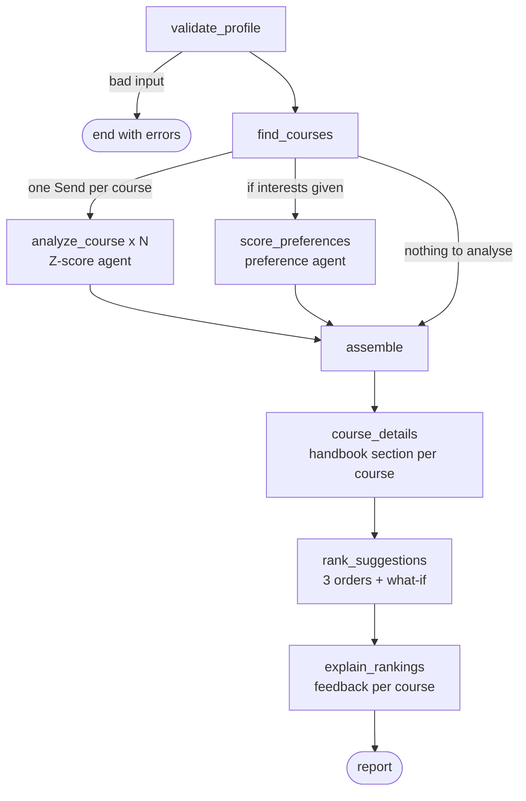

# CampusYamu architecture

CampusYamu turns the UGC *Student Handbook 2024/2025* into an admissions advisor:
which courses a student can apply for, how their Z-score compares with past
cut-offs, how far each campus is from home, which courses fit their interests,
and in what order to list them. Every number comes from data the project builds
and checks; language models only read free text (interests, questions) and word
explanations.

## Student pipeline (LangGraph)

`src/campusyamu/pipeline/graph.py` — one run per student, used by the CLI and the API.



| Node | Agent | What it does | LLM |
| --- | --- | --- | --- |
| validate_profile | course_finder | A/L subjects and grades, admission district (§1.5), home DS division | – |
| find_courses | course_finder + knowledge_graph + travel_time | A/L eligibility from the graph's rules, O/L checks, aptitude tests, teaching site and travel time per offering | – |
| analyze_course | zscore | past cut-offs for the admission district, calibrated estimate ± uncertainty, band | – |
| score_preferences | preference | interests → categories; match (1–10), mismatch (−1…−10), net per course | 1 call (keyword fallback) |
| assemble | – | bands, interest groups, preference score per row | – |
| course_details | course_details | the course's own handbook block (programmes, duration, medium, notes) | – |
| rank_suggestions | ranking | order 1 Z-score, order 2 interests + cut-off, order 3 + distance; what-if re-ranking | – |
| explain_rankings | ranking.feedback | summary, a note per course, "if you care more about…" advice | 1 call (template fallback) |

## Components

```
src/campusyamu/
├── core/              paths.py (every file location), settings.py (config/settings.yaml), openai_client.py
├── knowledge_graph/   handbook → tables/prose → A/L rules → NetworkX graph; eligibility checker; Neo4j export; graph chatbot
├── handbook_search/   parent/child chunks, OpenAI embeddings, Neo4j vector + BM25, RRF, optional cross-encoder rerank
├── agents/
│   ├── course_finder/   step 1: courses a student can apply for
│   ├── zscore/          historical cut-off analysis (SQLite)
│   ├── travel_time/     DS division × campus road matrix (SQLite), teaching-site placement
│   ├── course_details/  handbook block per course, found by course code
│   ├── preference/      interest categories, match/mismatch marks
│   ├── ranking/         suggestion orders, what-if sensitivity, feedback
│   └── career_trends/   web research (Tavily/Firecrawl, Reddit) + research agent + cited future SWOT
├── pipeline/          the LangGraph student pipeline + CLI
└── web/               stdlib HTTP server, single-page UI, course chat, career-outlook cache
```

## Data

```
data/
├── raw/          as received: handbook PDF/Markdown + UGC tables, travel CSVs, Z-score DB
├── reference/    owner-curated: owner_interpretations, A/L subject list, course categories, travel decisions
├── processed/    built by the pipelines: knowledge_graph/ (graph, rules, chunks, embeddings), travel/travel_times.db
└── cache/        career_paths_cache.json, career_outlooks/<course>.json (web research, reused across students)
outputs/          reports and run outputs (gitignored)
config/           settings.yaml — weights, thresholds, default models, web port
```

`data/processed/knowledge_graph/source_registry.json` records each raw source's
path and SHA-256; the build refuses to use a changed source until it is
re-registered (`make kg`).

## Rules and provenance

* **A/L eligibility** — handbook prose is parsed deterministically where possible;
  remaining clauses were proposed by a model, verified, and accepted only when a
  behavioural check over every subject/grade combination agrees
  (`knowledge_graph/al_rule_semantics.py`). Ambiguous wording is settled by the
  project owner in `data/reference/owner_interpretations.json`, with test cases.
* **Arts stream** — §2.2.1.1 basket rules are executed directly (`arts_rules.py`).
* **"N other subjects"** — such clauses are checked jointly with the grade clauses,
  so one subject cannot satisfy both.
* Every eligibility answer cites the handbook section and page.

## Language-model use and guardrails

| Where | Input | Output | Guardrails |
| --- | --- | --- | --- |
| preference | student's interests | categories + marks per eligible course | strict JSON schema with enums; unknown ids dropped; missing marks filled from reviewed category marks |
| ranking feedback | computed what-if facts | summary + note per course | may only reference given courses; template fallback |
| course chat | question + course section + student's facts + handbook search + career outlook | cited answer | answer only from numbered sources; never promise admission; unknown source ids dropped |
| career research | course name | cited 5-year SWOT | runs only when a student asks; evidence-referenced findings, guardrails in `career_trends/analysis_guardrails.py` |
| knowledge graph | handbook clauses | rule proposals | offline, owner-reviewed; not used at request time |

Every prompt lives in `src/campusyamu/prompts/` (one module per area); `python -m campusyamu.prompts` lists them and `python -m campusyamu.prompts <name>` prints one exactly as sent.

All calls use the OpenAI Responses API with `store: false`. Keys live in `.env`;
models default from `config/settings.yaml` and can be overridden per role.

## API and web page

`python -m campusyamu.api` (port 8780) is the only backend: a FastAPI service
(`src/campusyamu/api/`) with `GET /v1/options`, `GET /v1/courses`,
`POST /v1/recommendations` (the pipeline), `POST /v1/chat` (course chat),
`GET /v1/career-outlook` and `POST /v1/career-outlook/research` (background job).
`api/service.py` (`AdvisorService`) holds the logic; `api/app.py` runs every call on
one worker thread (the pipeline's SQLite connections are bound to it) and career
research in a background thread. Full client guide: [API.md](API.md).

Course research (`web/course_research.py`, `make research COURSE=… UNI=…`) runs three sub-agents in
parallel for one offering: the career-trends agent (web + Reddit, cited SWOT; cached per course), the
university-website agent (`web/university_pages.py`: a search limited to the owner-reviewed domains in
`data/reference/university_domains.json`, read by the LLM into an applicant profile) and the specialisation
agent (one official-site search per specialisation, in parallel, then a card each; names from the handbook,
else from the website profile). Website and specialisations are cached per offering in
`data/cache/university_pages/`. The course chat starts it when the student asks for research and reads
the cache as sources W and D (`chat.website.enabled` in settings).

Chat memory (`src/campusyamu/memory/`, settings `memory:`) keeps each signed-in student's course chats on
the server: one conversation per student per offering, every message, a running summary of older turns,
and a short list of lasting student facts shared by all their chats. Per question the chat gets the facts,
the summary and the newest turns that fit `memory.recent_tokens`; a follow-up is rewritten to stand alone for
the handbook search; afterwards the turn is saved and, in a background thread, older turns are folded into
the summary and new facts are extracted (small `models.memory` calls; prompts in `prompts/memory.py`). The
store is Supabase Postgres when `SUPABASE_DB_URL` is set (tables: `supabase/migrations/`), otherwise a SQLite
file. Sign-in is Supabase Auth: with `SUPABASE_URL` set, every /v1 endpoint except /v1/health needs the
student's access token (`api/auth.py`, checked locally against the project's signing keys), `/v1/chat` uses
that student's memory, `/v1/me/chats...` returns their saved chats, and `api/limits.py` caps the paid calls
per student per day (`limits:` in settings; counts in `daily_usage`). Without `SUPABASE_URL` the API is open
(local development) and the chat uses the client's `history`. Try memory from the terminal with
`uv run python -m campusyamu.memory chat --user <uuid> --uni-code 008G`.

`python -m campusyamu.web` (port 8770) only serves the page
(`web/static/index.html`); the page calls the API at `API_BASE_URL`, like the mobile app.
